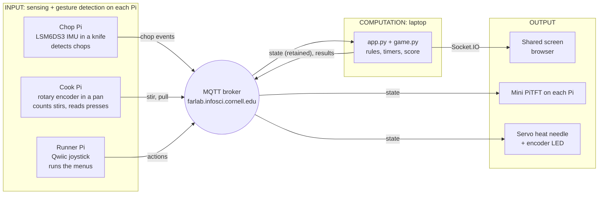
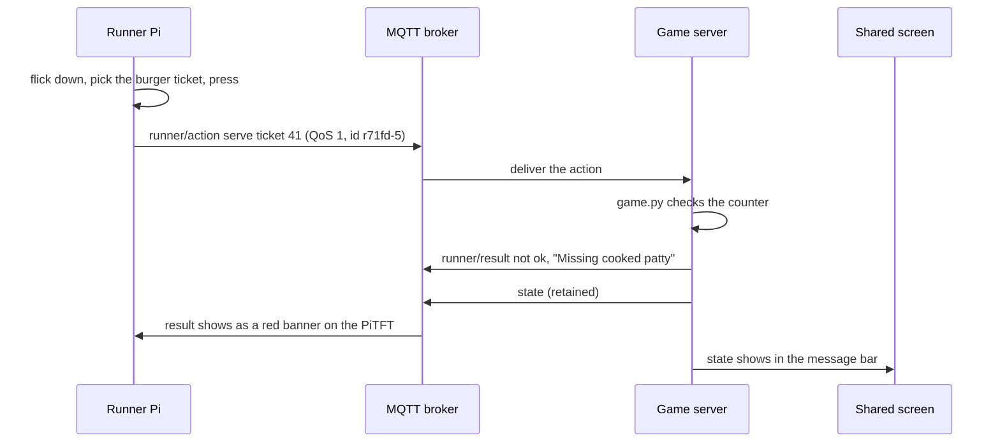

# Order Up! A co-op kitchen on three Raspberry Pis
 
**Team:** NAME 1 · NAME 2 · NAME 3 <!-- TODO: replace with our names -->
 
Three players, three Raspberry Pis, one shared screen, and a 3-minute dinner rush. The **Runner** can move food but can't cook it. The **Chopper** and the **Cook** can prepare food but can't move it. The only way to serve an order is to talk to each other.
 

 
*The shared screen in the middle of a busy round: four tickets, a full counter, a chop waiting for space and a patty about to burn.*
 
---
 
## 1. Project description
 
### The story
 
It's 6:58 on a Friday and the diner opens in two minutes. Three cooks stand at their stations facing the order screen.
 
The **Runner** holds a joystick. It's the only person who can reach the pantry, carry food between stations, throw things out and hand plates to customers. The **Chopper** holds a cardboard knife and can turn lettuce and tomatoes into something usable, but can't move anything. The **Cook** grips a cardboard pan with a knob in its handle. Stirring cooks the food, and a needle on the stove creeps from *cold* to *done* to *burnt*.
 
Then the tickets start printing.
 
A **burger** comes in. The Runner flicks up to **Get** lettuce and flicks right to **Send** it to the chopping board. "Lettuce coming!" The Chopper hacks at the board, and each chop lights a dot on their screen. After six chops the lettuce slides back to the counter on its own. Meanwhile the Runner has sent a raw patty to the pan. The Cook stirs, the needle climbs, and the knob starts blinking green: **PULL! 8s**. "Patty's done!" Click: the patty is on the counter. The Runner grabs a bun, flicks down to **Serve**, picks the burger ticket and presses. +20 points, plus a tip for speed.
 
Not every plate goes that well. Send a bun to the chopping board and it comes back **ruined**. Forget the patty and it **burns**, then sits on the counter taking up one of only six slots until someone trashes it. Try to serve too early and the screen tells everyone exactly what's missing: *"Missing cooked patty."* Let a ticket run out and the team loses 10 points.
 
Three minutes later it's **TIME!** and the screen shows the final score, along with how many plates were served, expired and burnt.
 
### Why it's interesting
 
- **The network makes the teamwork possible, and the split makes it necessary.** No player can finish an order alone, so the real interaction happens between people. The Pis just make sure everyone sees the same kitchen.
- **Each Pi senses a different body movement.** Chopping is a sharp jolt picked up by an IMU. Stirring is continuous rotation on an encoder. Dispatching is quick, precise joystick flicks.
- **Shared and private screens.** The big screen shows the state of the whole kitchen. Each Pi's small screen shows only what that role needs right now.
### What each player does
 
| Role | Holds | Does | Sees and feels |
| --- | --- | --- | --- |
| Runner | Qwiic joystick | Flick **up** Get, **right** Send, **left** Trash, **down** Serve; press to confirm | Menus on the Mini PiTFT; a green or red banner for every result |
| Chopper | Knife with an LSM6DS3 IMU inside | Chop on the board (6 chops per item) | The item and 6 progress dots; the screen flashes yellow on every chop |
| Cook | Pan with a rotary encoder in the handle | Turn the knob to stir; press it to take food off the heat | A progress bar, a servo "heat needle" (cold, done, burnt) and a blinking knob LED |
| Everyone | Nothing: they shout | Read the shared screen | Tickets counting down (they shake under 10 seconds), the counter, both stations, the score |
 
### Rules
 
| Order | Needs | Prep path | Points |
| --- | --- | --- | --- |
| Salad | chopped lettuce + chopped tomato | chop, chop | 10 |
| Burger | bun + cooked patty + chopped lettuce | cook, chop | 20 |
| Tomato soup | soup | chop a tomato, then cook it | 20 |
 
- The counter has **6 slots**. A full counter blocks Get, and a finished chop waits on the board until a slot opens.
- Each station holds one item. Chopping takes **6 chops**. Cooking takes **30 encoder ticks** of stirring, and progress stops when stirring stops.
- Once food is done, the Cook has **8 seconds** to pull it before it burns.
- Up to **4 tickets** show at once, and a new one arrives about every **20 seconds**. Each lasts **60 seconds**. Serving scores the points plus a tip of up to 10 for speed. An expired ticket costs 10 points.
- A round lasts **3 minutes**.
---
 
## 2. Architecture
 
One **game server on a laptop** holds all of the game state and applies every rule. The Pis turn sensor data into game events and show what the server tells them.
 

 
### Hardware
 
| Station | Input | Output | Parts (I2C address) |
| --- | --- | --- | --- |
| Chop Pi | Chop motions | Item and chop progress on the PiTFT | LSM6DS3 IMU (`0x6a`) in a cardboard knife on a Qwiic cable |
| Cook Pi | Encoder turn = stir, press = pull | Servo needle, encoder LED, PiTFT | Adafruit I2C rotary encoder (`0x36`), SparkFun Servo pHAT (`0x40`) with its own USB-C power |
| Runner Pi | Joystick flicks and press, PiTFT buttons | Menus on the PiTFT | SparkFun Qwiic joystick (`0x20`) |
| Laptop | Space or Esc on the shared screen (start a round, back to the lobby) | Shared screen in a browser | Monitor or projector |
 
Every Pi also uses its Mini PiTFT (240 × 135) and Qwiic SHIM.
 
### One action, start to finish
 
Here's what happens when the Runner tries to serve a burger before the patty is ready:
 

 
Moving through the menus never touches the network. Only the confirmed action does, so the menus feel instant.
 
---
 
## 3. Build documentation
 
### Photos
 
| Station | Photo |
| --- | --- |
| Chop Pi + knife | TODO: add photo |
| Cook Pi + pan + needle | TODO: add photo |
| Runner Pi + joystick | TODO: add photo |
| The whole setup | TODO: add photo |
 
<!-- Add photos with:  -->
 
### Screens
 
| Shared screen: lobby | Shared screen: mid-round |
| --- | --- |
|  |  |
| **Shared screen: game over** | **Every Pi screen** |
|  |  |
 
*These screenshots use the real screen code with test game states, captured before the hardware playtests.*
 
### MQTT topics
 
Everything lives under `IDD/orderup/`. The example payloads are real messages from our test runs.
 
| Topic | From → to | Example payload | QoS |
| --- | --- | --- | --- |
| `chop/event` | Chop → server | `{"type":"chop"}` | 0 |
| `cook/event` | Cook → server | `{"type":"stir","ticks":5}` or `{"type":"pull","id":"c7f38-3"}` | 0 for stir, 1 for pull |
| `runner/action` | Runner → server | `{"action":"get","item":"lettuce","id":"r71fd-2"}`; also `send`, `trash`, `serve`, `start` | 1 |
| `runner/result` | Server → Runner | `{"id":"r71fd-5","ok":false,"msg":"Missing chopped lettuce + chopped tomato"}` | 1 |
| `cook/result` | Server → Cook | `{"id":"c7f38-3","ok":true,"msg":"Pulled cooked patty"}` | 1 |
| `state` | Server → everyone | Full game state (below) | 1, retained |
| `<station>/online` | Each Pi → server | `1`, or `0` from its last will | 1, retained |
| `server/online` | Server → Pis | `1`, or `0` from its last will | 1, retained |
| `ping`, `pong/<station>` | Network check | `{"n":3,"station":"laptop"}` | 0 |
 
The state message, shortened:
 
```json
{
  "phase": "playing", "time_left": 102, "score": 140,
  "tickets": [{"id": 41, "recipe": "burger", "time_left": 38, "needs": ["bun", "cooked_patty", "chopped_lettuce"], "ready": false}],
  "counter": ["bun", "chopped_lettuce", "burnt", null, null, null],
  "chop": {"item": "tomato", "progress": 4, "needed": 6, "result": null, "waiting": false},
  "cook": {"item": "patty", "progress": 0.6, "status": "cooking", "burn_in": null},
  "online": {"chop": true, "cook": true, "runner": true},
  "message": {"text": "Sent patty to cook", "ok": true, "station": "runner"}
}
```
 
### Code
 
All the code is in [`order-up/`](order-up/). Setup steps are in [`order-up/README.md`](order-up/README.md).
 
```text
order-up/
├── server/game.py          # every rule; no network code, so it's easy to test
├── server/app.py           # MQTT <-> game.py <-> Socket.IO; publishes state
├── server/templates/       # the shared screen
├── pi/common.py            # broker settings + StationLink (MQTT, online/last will)
├── pi/chop_station.py      # IMU -> chops
├── pi/cook_station.py      # encoder -> stir/pull, servo needle, LED
├── pi/runner_station.py    # joystick -> menus (pi/runner_menu.py)
├── sim/sim_station.py      # keyboard stand-in for any or all Pis
└── tests/                  # 49 pytest tests
```
 
**Detecting a chop (Chop Pi).** We measure how far the total acceleration is from 1 g, so the knife's tilt doesn't matter. A chop counts when that jumps past a threshold. The detector then waits until the knife settles and a short lockout passes, so one impact that rings doesn't count twice.
 
```python
def update(self, ax, ay, az, now):
    self.motion = abs(math.sqrt(ax * ax + ay * ay + az * az) - GRAVITY)
    since = now - self.last_chop
    if not self.armed:
        if self.motion < self.rearm and since >= self.lockout:
            self.armed = True
        return False
    if self.motion >= self.threshold and since >= self.lockout:
        self.armed = False
        self.last_chop = now
        return True
    return False
```
 
**Stirring without flooding the broker (Cook Pi).** The encoder is read 60 times a second, but stirs go out at most 5 times a second, with the ticks added up in between. Turning either way counts.
 
```python
def update(self, position, now):
    if self.last_position is not None:
        moved = abs(position - self.last_position)
        if moved:
            self.pending += moved
            self.last_stir = now
    self.last_position = position
    if self.pending and now - self.last_sent >= self.gap:
        ticks, self.pending = self.pending, 0
        self.last_sent = now
        return ticks
    return 0
```
 
**Every action happens exactly once (server).** QoS 1 guarantees delivery but can deliver a message twice. Every Runner action and every pull carries an id. The server remembers its answer for each id and replays it instead of, say, getting two tomatoes.
 
```python
msg_id = payload.get("id")
key = (station, msg_id)
if msg_id is not None and key in self._results:
    return self._results[key]
result = handler()
```
 
Ids look like `r71fd-5`: the station's first letter, a random session code, then a counter. A Pi that restarts never reuses an id.
 
**Knowing who's connected.** Each station registers a retained *last will* before it connects. If a Pi loses power, the broker publishes `0` for it, and the shared screen marks that station offline. The server does the same, so a Pi can show "No server" instead of "No broker".
 
```python
self.client.will_set(self.topic(station, "online"), "0", qos=1, retain=True)
# ...and once connected:
client.publish(self.topic(self.station, "online"), "1", qos=1, retain=True)
```
 
---
 
## 4. How we built it
 
### From plan to code
 
We started with a written [game plan](GAME_PLAN.md) covering the rules, roles, MQTT topics and a build order of 11 milestones. The key decision was **one server as the single source of truth**. The Pis never disagree about what's on the counter, and a Pi that restarts catches up from the retained state message.
 
We split the code so most of it could be built and tested before any hardware worked:
 
1. **Rules first, with no network code.** `game.py` takes actions and the current time and returns state. That let us play whole rounds in tests in milliseconds.
2. **A simulator before the stations.** `sim_station.py` speaks the same MQTT as the Pis, so one laptop can play a full round. It also stands in for any Pi that's missing on test day.
3. **Hardware logic separated from hardware access.** Chop detection, stir counting, joystick flicks and the Runner's menus are plain classes with tests. Only a thin layer touches I2C.
### Milestones
 
| # | Milestone | Status |
| --- | --- | --- |
| 1 | Parts check | TODO: `i2cdetect` on each Pi |
| 2 | Network check | Tool ready (`pi/network_check.py`). TODO: measure on the class broker |
| 3 | Game rules | Done: `game.py` + 31 rule tests |
| 4 | Shared screen | Done: a full round is playable from the simulator |
| 5 | Chop station | Code done and tested with fake sensors. TODO: tune `CHOP_THRESHOLD` with real swings |
| 6 | Cook station | Code done and tested with fake sensors. TODO: check needle direction on the real dial |
| 7 | Runner station | Code done and tested with fake sensors. TODO: check the joystick's orientation |
| 8 | Team playtest | TODO |
| 9 | Props | TODO |
| 10 | User test | TODO |
| 11 | Documentation | This README |
 
### Testing without hardware
 
- **49 automated tests** cover the recipes, the counter, burning, scoring, expiry, duplicate messages, bad payloads, chop detection, stir counting, joystick flicks and every Runner menu.
- **Scripted rounds over MQTT** against a local Mosquitto broker. A script acted like all three Pis, served an order, burnt a patty, and cut one station's connection to check it showed as offline.
- **Fake sensor modules** stood in for the IMU, encoder, servo and joystick, so the real station scripts ran end to end.
- **Screenshots** of the shared screen at three screen sizes, and images of every PiTFT screen.
### Bugs we caught
 
| Bug | How we found it | Fix |
| --- | --- | --- |
| A patty stirred in steps of 5 ticks never finished cooking | Scripted MQTT round. The unit test had stirred 30 ticks at once, so it missed this | Six steps of 5/30 add up to 0.9999… in floating point. We count whole ticks instead |
| The orders row pushed both stations off the bottom of a 1600 × 900 screen | Screenshots | Sized the layout to the window so everything fits on a laptop or a projector |
| On the Runner's home screen, "TRASH" overlapped the counter count, and a selected ready order was green text on a blue highlight | Rendered PiTFT images | Moved the count and colored the highlight by status |
| Connection messages printed straight into the simulator's text display | Running the simulator | Sent those messages to the simulator's own log |
| The Send list reopened on the last slot used, so even our test script picked the wrong item | Scripted simulator run | Every list now opens at the top |
| Port 5000 is often taken by AirPlay on Macs | Setup | The shared screen runs on port 5050 |
 
### Decisions we made while coding
 
- A wrong item still gets processed and comes out **ruined**. Ruined and burnt food can only be trashed.
- The Cook can't pull food before it's done. Burnt food goes to the counter and has to be trashed.
- Send and Trash include the item the Runner picked. If the counter changed in the meantime, the server refuses: "Counter changed. Try again."
- Get and Trash stay in their list for repeat actions. Send and Serve go back home.
---
 
## 5. User testing
 
> TODO: test with 2+ people who aren't on our team, and fill in below.
 
| Tester | What did they expect before trying? | What surprised them? | What would they change? |
| --- | --- | --- | --- |
| Tester 1 (role: ) | | | |
| Tester 2 (role: ) | | | |
 
**Photos or video:** TODO
 
**What we changed after testing:** TODO
 
<!-- Suggested protocol: explain the game in one sentence ("you can only do your own job, so talk"),
     play one practice round and one scored round, then ask the three questions above.
     Note how long the Runner takes per action, and whether chops were missed or double-counted. -->
 
---
 
## 6. Reflection
 
**What worked well**
 
- One server as the single authority. Nothing ever disagreed about the counter, and restarting a Pi mid-round just worked because the state is retained.
- Writing the rules with no network code. We could test every edge case in under a second.
- The simulator. One person could play a whole round on a laptop while the stations were still being built.
- *TODO: add what worked in the real playtests.*
**Challenges with distributed interaction**
 
- **Duplicates.** QoS 1 can deliver a message twice, so actions needed ids and the server needed to remember its answers.
- **Ordering.** The server publishes from two threads (the timer loop and incoming messages), so we had to lock publishing to keep an older state from overwriting a newer one.
- **Knowing who's there.** A Pi that loses power can't say goodbye, so we rely on MQTT last-will messages.
- **Hiding latency.** Menus stay on the Runner's Pi, the chop screen flashes before the server confirms, and the heat needle counts down locally between state updates.
- *TODO: what the real round-trip times were, and whether players noticed any lag.*
**How the sensor events worked**
 
The three stations send three kinds of events. A chop is a **discrete event**, one message per detected impact. Stirring is a **continuous signal**, so we add up encoder ticks and send them at most 5 times a second. The Runner sends **decisions**: only confirmed actions, never raw joystick data.
 
*TODO: how reliably real chops were detected, and what threshold we ended up with.*
 
**What we'd improve**
 
- *TODO: from playtesting.*
- Ideas from the plan: Serve could pick the oldest ready order automatically if menus feel slow, add more recipes so every station stays busy, and add a "head chef" line between rounds as a stretch idea.
**Where computation happens, and why**
 
| Where | What | Why |
| --- | --- | --- |
| Pis | Turning raw sensor data into chops, stirs and menu choices | Needs fast sampling (the IMU at 250 Hz), and sending raw sensor data over the network would be wasteful |
| Laptop | Rules, timers, score | The game needs one authority |
| Browser | Drawing the shared screen and its animations | Keeps display code separate from game logic |
 
We didn't use a language model. The game needs fast, predictable rules, which plain code handles better.
 
---

## Submission Checklist

Before submitting:
- [ ] Delete prep/instructions above
- [ ] Add YOUR project documentation
- [ ] Include photos/videos/diagrams  
- [ ] Document user testing with non-team members
- [ ] Add reflection on learnings
- [ ] List team names at top

**Your README = story of what YOU built!**

---

Resources: [MQTT Guide](https://www.hivemq.com/mqtt-essentials/) | [Paho Python](https://www.eclipse.org/paho/index.php?page=clients/python/docs/index.php) | [Flask-SocketIO](https://flask-socketio.readthedocs.io/)
