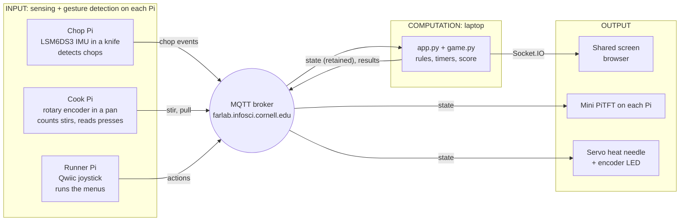
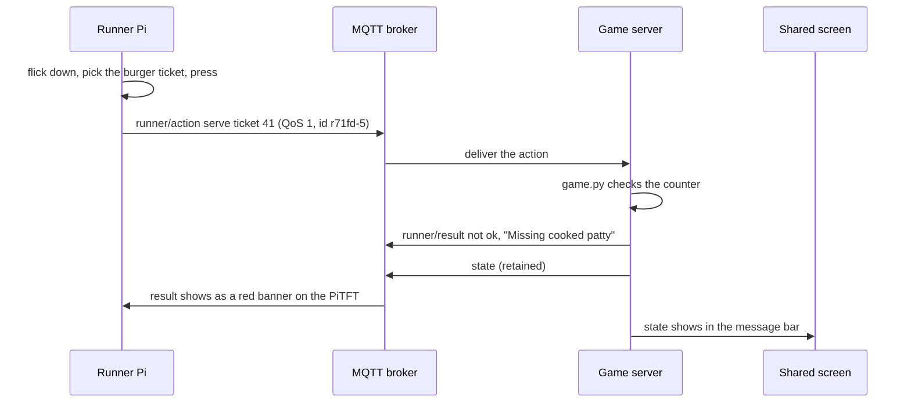

# Distributed Interaction
 
**Team:** Rohil Saraf, Yuxuan Wang (yw2946), Max Corkran (mc3223), Xie Li (xl2323)
 
Our project is **Order Up!**, a co-op cooking game for three players on three Raspberry Pis.
 
---
 
## Part A: MQTT Messaging

I installed `mosquitto-clients` on my Pi and tested publish/subscribe with the class broker at `farlab.infosci.cornell.edu:1883`.

- **Subscriber:** listened on `IDD/#` (the `#` wildcard catches every topic under `IDD/`)
- **Publisher:** sent `Hello!` on `IDD/test/rohil`

The message showed up in the subscriber terminal right away and in the web debug viewer at `http://farlab.infosci.cornell.edu:5001`.

<!-- IMAGE: terminal showing "Hello!" received -->


<!-- IMAGE: MQTT viewer on :5001 showing IDD/test/rohil -->


### 5 Ideas for Messaging Between Devices

1. **Remote doorbell.** A proximity sensor at the door publishes `IDD/home/door/visitor`, and a Pi in another room flashes its screen.
2. **"At my desk" presence light.** Each roommate's Pi publishes whether someone is sitting nearby, and everyone sees who's home on a shared display.
3. **Plant check-in.** A moisture or light sensor next to a plant publishes readings, and a friend's Pi shows a sad face when the plant needs attention.
4. **Long-distance high five.** Waving at your Pi (gesture sensor) lights up a friend's Pi somewhere else, and they wave back.
5. **Co-op cooking game (Order Up!).** Three Pis each do one job (joystick, knife, pan) and send events to a shared screen, so the team has to talk to finish orders. This is the idea we built for Part C.

**On topic design:** MQTT doesn't fix any vocabulary in advance. We had to invent our own topic names and message formats, while a standard like Matter defines what a "light" or "sensor" means for you. That made our system easy to start but meant we had to agree on topics as a team (see Part C).

---

## Part B: Collaborative Pixel Grid

Each Pi acts as one pixel on a shared web grid. The APDS-9960 sensor reads the color of whatever is held near it, the Pi publishes that color over MQTT, and the server updates the grid in the browser in real time.

**Architecture:** `Pi (APDS-9960 color sensor) → MQTT broker → Server → Web browser grid`

**Setup:**
- Connected the APDS-9960 with a Qwiic cable and confirmed it at address `0x39` with `i2cdetect -y 1`
- Ran `pixel_grid_publisher.py` on the Pi
- Viewed the grid at `http://farlab.infosci.cornell.edu:5000`

Holding red, green and blue objects over the sensor changed my pixel within about a second.

<!-- IMAGE: screenshot of the pixel grid with my pixel -->


<!-- IMAGE: photo of my Pi with the sensor connected -->


---

---

## Part C: Order Up!
 

 
### 1. Project Description
 
**What does it do?**
 
Order Up! is a 3-minute kitchen rush. Orders show up on a big shared screen, and the three of us have to make and serve as many as we can before time runs out. The catch is that nobody can do everything:
 
- The **Runner** has a joystick. They're the only one who can grab ingredients, move food between stations, throw things away and serve orders. They can't prepare anything.
- The **Chopper** has a cardboard knife with an accelerometer inside. Chopping on the board turns lettuce and tomatoes into chopped lettuce and chopped tomato.
- The **Cook** has a cardboard pan with a knob in the handle. Turning the knob stirs, and pressing it takes the food off the heat.
The Chopper and Cook can prepare food but can't move it, so the only way to get anything done is to talk.
 
Here's what making a burger looks like. The Runner flicks the joystick up to get some lettuce, then flicks right to send it to the chopping board ("lettuce coming!"). The Chopper chops six times, and the lettuce goes back to the counter on its own. Meanwhile the Runner has sent a raw patty to the pan. The Cook stirs until the needle on the stove reaches "done". Then the knob starts blinking green with an 8-second countdown on their screen, and they press it to pull the patty off before it burns. The Runner grabs a bun, flicks down to serve, picks the burger ticket, and the team gets 20 points plus a tip for being quick.
 
Things go wrong in fun ways. If you send a bun to the chopping board, it comes back ruined. If you forget the patty, it burns. Either way the mess takes up one of the counter's six spots until someone trashes it. If you try to serve too early, the screen tells everyone exactly what's missing, like "Missing cooked patty". If a ticket runs out, you lose 10 points.
 
| Order | Needs | Points |
| --- | --- | --- |
| Salad | chopped lettuce + chopped tomato | 10 |
| Burger | bun + cooked patty + chopped lettuce | 20 |
| Tomato soup | a tomato that's been chopped, then cooked | 20 |
 
Up to 4 tickets are on screen at once, a new one comes in about every 20 seconds, and each one lasts 60 seconds.
 
**Why is it interesting?**
 
What we liked about this idea is that the network isn't the point, the people are. Each Pi only does one job, so the game forces the three of us to coordinate out loud. It's also a good mix of sensing: chopping is a quick jolt, stirring is continuous rotation, and the Runner's flicks are fast, precise choices. The two kinds of screens also do different jobs. The big screen shows the whole kitchen, and each Pi's little screen shows only what that person needs right now.
 
**User experience**
 
| Player | Does | Gets feedback from |
| --- | --- | --- |
| Runner | Flicks up for Get, right for Send, left for Trash, down for Serve; presses to confirm | Menus on the Pi screen, plus a green or red message after every action |
| Chopper | Chops on the board | The item and 6 progress dots; the screen flashes yellow on every chop |
| Cook | Turns the knob to stir; presses it to pull | A progress bar, a servo needle that moves from cold to done to burnt, and a blinking knob |
| Everyone | Watches the shared screen and yells | Tickets that shake when they're under 10 seconds, the counter, both stations, the score |
 
### 2. Architecture Diagram
 
The laptop runs the game server, which keeps track of everything and applies the rules. The Pis read their sensors, turn that into game events (a chop, some stirring, a menu choice), and show whatever the server sends back. Everything goes through the class MQTT broker.
 

 
**Hardware and connections**
 
| Station | Input | Output | Parts |
| --- | --- | --- | --- |
| Chop Pi | Chopping motion | Item and progress on the Pi screen | LSM6DS3 IMU (I2C `0x6a`) inside the knife, on a Qwiic cable |
| Cook Pi | Turning (stir) and pressing (pull) the encoder | Servo needle, the encoder's LED, Pi screen | Adafruit I2C rotary encoder (`0x36`), SparkFun Servo pHAT (`0x40`) on its own USB-C power |
| Runner Pi | Joystick flicks and press, the Pi screen's two buttons | Menus on the Pi screen | SparkFun Qwiic joystick (`0x20`) |
| Laptop | Space or Esc on the shared screen (start a round, back to the lobby) | The shared screen in a browser | A monitor or projector when we have one |
 
All three Pis also have a Mini PiTFT and a Qwiic SHIM.
 
**Data flow for one action.** Here's what happens when the Runner tries to serve a burger that isn't ready yet:
 

 
Scrolling through menus never touches the network. Only the confirmed action gets sent, which keeps the menus feeling instant.
 
### 3. Build Documentation
 
**Photos of each Pi + sensors**
 
| Station | Photo |
| --- | --- |
| Chop Pi + knife |  |
| Cook Pi + pan + needle |  |
| Runner Pi + joystick |  |
 
<!--  -->
 
**Screens**
 
**Lobby**
 

**Mid-Round**

 
**Game over** 


**Pi-screens**
  
 
_These screenshots came from our test runs, before we played with the real hardware._
 
**MQTT topics used**
 
Everything is under `IDD/orderup/` so we stay in our own team space. The example payloads are real messages from our test runs.
 
| Topic | From → to | Example | QoS |
| --- | --- | --- | --- |
| `chop/event` | Chop → server | `{"type":"chop"}` | 0 |
| `cook/event` | Cook → server | `{"type":"stir","ticks":5}` or `{"type":"pull","id":"c7f38-3"}` | 0 for stir, 1 for pull |
| `runner/action` | Runner → server | `{"action":"get","item":"lettuce","id":"r71fd-2"}` (also `send`, `trash`, `serve`, `start`) | 1 |
| `runner/result` | Server → Runner | `{"id":"r71fd-5","ok":false,"msg":"Missing chopped lettuce + chopped tomato"}` | 1 |
| `cook/result` | Server → Cook | `{"id":"c7f38-3","ok":true,"msg":"Pulled cooked patty"}` | 1 |
| `state` | Server → everyone | The whole game state (below) | 1, retained |
| `<station>/online` | Each Pi → server | `1`, or `0` from its last will | 1, retained |
| `server/online` | Server → Pis | `1`, or `0` from its last will | 1, retained |
| `ping`, `pong/<station>` | Network check | `{"n":3,"station":"laptop"}` | 0 |
 
The state message (shortened) looks like this:
 
```json
{
  "phase": "playing", "time_left": 102, "score": 140,
  "tickets": [{"id": 41, "recipe": "burger", "time_left": 38, "needs": ["bun", "cooked_patty", "chopped_lettuce"], "ready": false}],
  "counter": ["bun", "chopped_lettuce", "burnt", null, null, null],
  "chop": {"item": "tomato", "progress": 4, "needed": 6, "result": null, "waiting": false},
  "cook": {"item": "patty", "progress": 0.6, "status": "cooking", "burn_in": null},
  "online": {"chop": true, "cook": true, "runner": true},
  "message": {"text": "Sent patty to cook", "ok": true, "station": "runner"}
}
```
 
**Code snippets with explanations**
 
The code is split so the rules don't know anything about the network, and the sensor logic doesn't know anything about the hardware. That made it possible to test most of it on a laptop.
 
```text
order-up/
├── server/game.py          # all the rules, no network code
├── server/app.py           # connects MQTT, game.py and the shared screen
├── server/templates/       # the shared screen
├── pi/common.py            # broker settings + StationLink (MQTT, online/last will)
├── pi/chop_station.py      # IMU -> chops
├── pi/cook_station.py      # encoder -> stir/pull, servo needle, LED
├── pi/runner_station.py    # joystick -> menus (pi/runner_menu.py)
├── sim/sim_station.py      # keyboard stand-in for any or all Pis
└── tests/                  # 49 tests
```
 
_Detecting a chop (Chop Pi)._ We look at how far the total acceleration is from 1 g, so it doesn't matter how the knife is tilted. When that jumps past a threshold, we count a chop. Then we wait for the knife to settle and for a short lockout to pass, so one hit that bounces doesn't count twice.
 
```python
def update(self, ax, ay, az, now):
    self.motion = abs(math.sqrt(ax * ax + ay * ay + az * az) - GRAVITY)
    since = now - self.last_chop
    if not self.armed:
        if self.motion < self.rearm and since >= self.lockout:
            self.armed = True
        return False
    if self.motion >= self.threshold and since >= self.lockout:
        self.armed = False
        self.last_chop = now
        return True
    return False
```
 
_Stirring (Cook Pi)._ We read the encoder 60 times a second, but we only send stirs at most 5 times a second, adding up the ticks in between. Turning either way counts.
 
```python
def update(self, position, now):
    if self.last_position is not None:
        moved = abs(position - self.last_position)
        if moved:
            self.pending += moved
            self.last_stir = now
    self.last_position = position
    if self.pending and now - self.last_sent >= self.gap:
        ticks, self.pending = self.pending, 0
        self.last_sent = now
        return ticks
    return 0
```
 
_Not doing things twice (server)._ QoS 1 makes sure a message arrives, but it can arrive twice. So every Runner action and every pull has an id, and the server remembers what it answered. If the same id shows up again, it just sends the same answer instead of, say, giving us two tomatoes.
 
```python
msg_id = payload.get("id")
key = (station, msg_id)
if msg_id is not None and key in self._results:
    return self._results[key]
result = handler()
```
 
The ids look like `r71fd-5`: the station's first letter, a random code for this run, and a counter. That way a Pi that restarts never reuses an old id.
 
_Knowing who's connected._ Each Pi sets a retained "last will" before it connects. If it loses power, the broker publishes `0` for it, and the shared screen shows that station as offline. The server does the same thing, so a Pi can tell "the server is down" apart from "I can't reach the broker".
 
```python
self.client.will_set(self.topic(station, "online"), "0", qos=1, retain=True)
# once connected:
client.publish(self.topic(self.station, "online"), "1", qos=1, retain=True)
```
 
**How we built it**
 
We wrote the game plan first: the rules, the roles, the MQTT topics, and a build order of 11 milestones. The biggest decision was to have one server be the single source of truth, so the Pis can never disagree about what's on the counter. A Pi that restarts just reads the latest retained state and catches up.
 
Then we built it in an order that didn't depend on hardware:
 
1. **Rules.** `game.py` only takes actions and the time, and gives back the state. We could play entire rounds inside tests in milliseconds.
2. **A simulator.** `sim_station.py` sends the exact same MQTT messages as the Pis, so one laptop can play a full round with the keyboard. It's also our backup if a Pi dies during a demo.
3. **The stations.** The sensor logic (chop detection, stir counting, joystick flicks, the Runner's menus) is plain Python that we can test. Only a thin layer actually talks to I2C.
| # | Milestone | Where we are |
| --- | --- | --- |
| 1 | Parts check | Done. All three Pis found their sensors and ran in the playtests |
| 2 | Network check | Script written (`pi/network_check.py`). Played on the class broker with no lag noticed by testers |
| 3 | Game rules | Done, with 31 tests for the rules |
| 4 | Shared screen | Done. A full round works from the simulator |
| 5 | Chop station | Code done and tested with fake sensors. Tested with real chops. Firm hits were reliable, but soft chops were missed or double-counted, so the threshold needed retuning |
| 6 | Cook station | Code done and tested with fake sensors. Tested with real stirring. The stirrer sat idle between orders, so it needs more to do |
| 7 | Runner station | Code done and tested with fake sensors. Tested with the real joystick. The Runner had too many things to do, so we plan to move its screen to the computer |
| 8 | Team playtest | Done. We played full rounds with all three stations |
| 9 | Props | Done. Each station is a Pi with its sensor on a table (see the photos above) |
| 10 | User test | Done. Feedback is in the User Testing section, and the video is linked there |
| 11 | Documentation | This README |
 
To test without hardware, we used 49 automated tests and played scripted rounds over MQTT against a local broker. One of those rounds cut a station's connection on purpose to check it showed up as offline. We also ran the real station scripts on fake sensor modules and took screenshots at three screen sizes. That caught some real bugs:
 
- **The patty never finished cooking.** Stirring in steps of 5 ticks added 5/30 six times, which comes out to 0.9999… in floating point, never quite 1. Our unit test stirred 30 ticks all at once, so it didn't catch this, but the scripted round did. Now we count whole ticks.
- **The shared screen didn't fit** on a 1600 × 900 screen: the orders pushed the stations off the bottom. We changed the layout to scale with the window.
- **The Runner's screen had overlapping text** on the home menu, and a selected order that was ready showed as green text on a blue highlight, which was hard to read.
- **The Send list remembered the last slot we used**, which tripped up even our own test script. Now every list starts at the top.
- **Port 5000 is taken by AirPlay on Macs**, so the shared screen runs on 5050.
### 4. User Testing
 
**Photos/video:** [Watch the video](https://youtu.be/tYx_nN-NGPU?is=ePFDDD0nZFNSiFBd)
 
| Tester | What did they think before trying? | What surprised them? | What would they change? |
| --- | --- | --- | --- |
| Tester 1 (played: Runner) | Thought it would be like a normal cooking game and expected to be able to chop or stir too. | Could only do their own job, so they had to talk to the others. Menus felt instant because scrolling never waits on the network. | Said the game was too fast, and the Runner had too many things to do. Wanted Serve to pick the oldest ready order automatically. |
| Tester 2 (played: Chop) | Expected the knife to register every motion. | The screen flashed right away on each chop. Some chops were missed or counted twice when the motion was soft. | Wanted the chop threshold tuned and clearer feedback for a missed chop. |
 
**What worked:** the one-sentence rule ("you can only do your own job, so talk to each other") was enough to start. Instant menus on the Runner and the immediate chop flash made the game feel responsive. Stations dropping and rejoining mid-round recovered without a restart.

**What did not:**
- **The game was too fast.** Testers could not keep up with the pace of orders.
- **Instructions were hard to take in.** It was hard to get hold of the rules before a round started.
- **The Runner had too many things to do.** They handled every delivery and menu, so they became the bottleneck.
- **The stirrer sat idle for some time.** Cook waited on Chop and Runner, so stirring had long gaps with nothing to do.
- Chop detection also missed soft chops and sometimes counted them twice.

**What we changed afterward:** we retuned the chop threshold and started every list at the top. Next we plan to slow the order pace, add a short instruction screen before each round, cut the Runner's menu steps (auto-pick the oldest ready order, and show the Runner screen on the computer screen so it is bigger and easier to read), and give the stirrer something to do while waiting.
 
<!-- Plan: explain it in one sentence ("you can only do your own job, so talk to each other"),
     play one practice round and one real one, then ask the three questions above.
     Watch how long the Runner takes per action and whether chops get missed or double-counted. -->
 
### 5. Reflection
 
**What worked well?**
 
Having one server in charge kept things simple. Nothing ever disagreed about the counter, and a Pi could restart mid-round and pick right back up. Keeping the rules separate from the network meant we could test every weird case in under a second. The simulator was a big help too, because one of us could work on the game while the others were still building stations. In the playtests, the "one job each" rule made players talk to each other, and a Pi reconnecting mid-round did not break the game.
 
**Challenges with distributed interaction?**
 
- **Duplicate messages.** QoS 1 can deliver something twice, so actions needed ids and the server had to remember its answers.
- **Messages out of order.** The server sends state from two places (its timer loop and incoming messages), so we had to make sure an older state could never be sent after a newer one.
- **Knowing who's actually there.** A Pi that loses power can't say goodbye, so we used MQTT's last-will messages.
- **Lag.** We kept the menus on the Runner's Pi, made the chop screen flash right away before the server confirms, and had the heat needle count down on its own between updates.
In playtests nobody complained about lag, since the menus run locally and the chop flash does not wait on the server. We did not measure exact round-trip times.
 
**How did sensor events work?**
 
Each station sends a different kind of event. A chop is a single event: one message per hit. Stirring is continuous, so we add up encoder ticks and send them at most 5 times a second. The Runner only sends decisions, never raw joystick data. With real chops, detection was reliable for firm hits but soft chops could be missed or double-counted. We kept the threshold adjustable and plan to make it more forgiving.
 
**What would you improve?**
 
From playtesting: slow the game down, make the instructions easier to absorb, reduce the Runner's workload (including moving the Runner screen onto the computer screen), keep the stirrer busy between orders, and make chop detection more forgiving. Some other ideas we already had: Serve could automatically pick the oldest order that's ready if the menus feel slow, we could add more recipes so every station stays busy, and a "head chef" voice between rounds would be a fun stretch.
 
**Where did computation happen, and why there?**
 
| Where | What | Why |
| --- | --- | --- |
| Pis | Turning raw sensor data into chops, stirs and menu choices | It needs fast sampling (the IMU runs at 250 Hz), and sending raw sensor data over the network would be wasteful |
| Laptop | Rules, timers, score | The game needs one place that decides what's true |
| Browser | Drawing the shared screen | Keeps the display separate from the game logic |
 
We didn't use a language model. The game needs fast, predictable rules, and plain code is better at that.
 

---

Resources: [MQTT Guide](https://www.hivemq.com/mqtt-essentials/) | [Paho Python](https://www.eclipse.org/paho/index.php?page=clients/python/docs/index.php) | [Flask-SocketIO](https://flask-socketio.readthedocs.io/)
